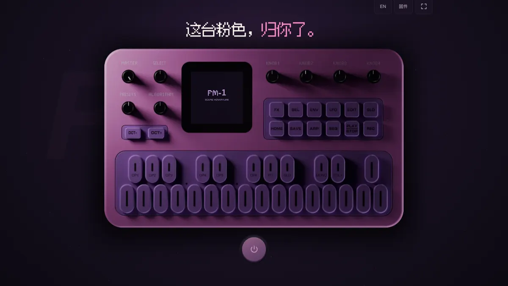
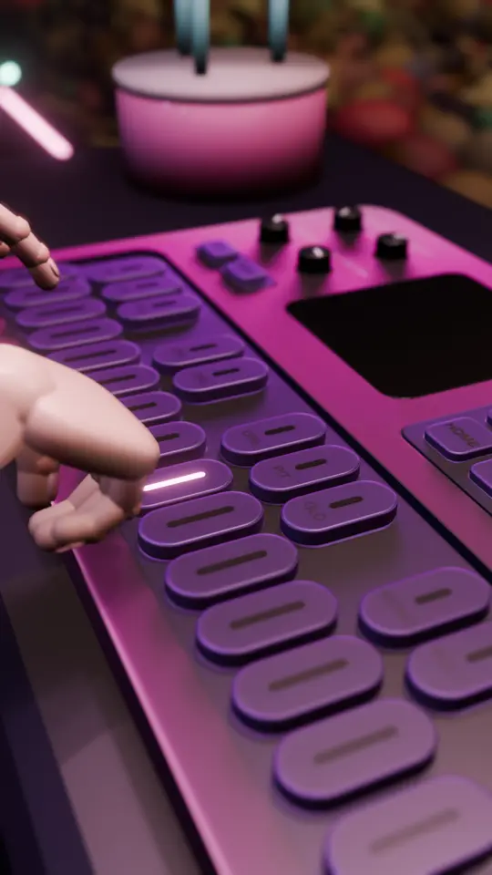
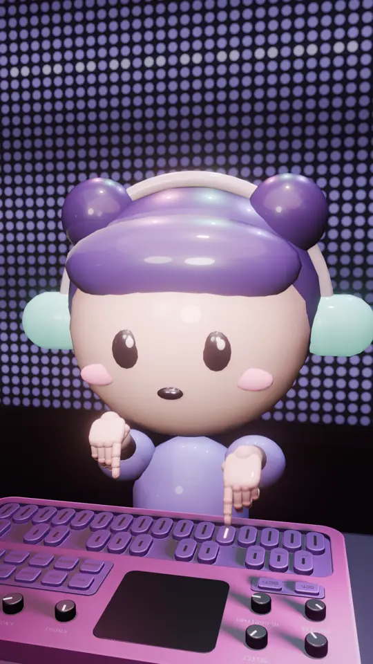

# DJ GAO · A Little Sound Adventure

一份生日礼物：一台粉色的合成器，一首她亲手弹出来的生日歌，一场只为她开的夜店派对。

*A birthday gift: a pink synth, a birthday song she plays herself, and a club night thrown just for her.*

**[打开它 → hudsonrivercrossing.github.io/DJGao](https://hudsonrivercrossing.github.io/DJGao/)**　手机、电脑都可以，开着声音。

## 怎么玩

1. 点开礼物，派对开场。
2. 打开这台粉色的 FM-1，跟着屏幕一步一步弹，录下生日歌的四个版本：八音盒、House Party、Birthday Drop、Hyper Encore。
3. 弹完，看属于她的生日现场，再分享到 Instagram。

## 生日现场

一段 87 秒的视频：她的手在琴键上，台下的人跟着跳，头顶放起烟花。

<table>
  <tr>
    <td></td>
    <td></td>
    <td></td>
    <td></td>
  </tr>
</table>

---

想知道它是怎么做的，看 [TECH.md](TECH.md)。
